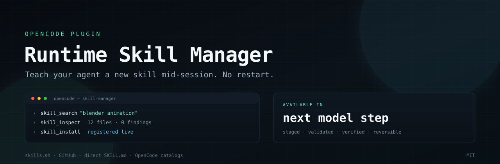

<p align="center">
  
</p>

<h1 align="center">OpenCode Runtime Skill Manager</h1>

<p align="center">
  <strong>Your agent can learn a new skill mid-session — without restarting OpenCode.</strong>
</p>

<p align="center">
  <a href="https://skills.sh/Loki-gold/opencode-runtime-skill-manager"></a>
  <a href="https://github.com/Loki-gold/opencode-runtime-skill-manager/blob/main/LICENSE"></a>
  
  
</p>

---

OpenCode has a skill system, but it is static: skills are files that must already be on disk when the session starts. Ask the agent for something outside its current skill set and the answer is usually "I don't have a skill for that".

**Runtime Skill Manager closes that gap.** It gives the agent five tools to search, inspect, install and uninstall Agent Skills while the session is running, then hot-registers them through OpenCode's own skill API. The installed skill is available on the **next model step**.

```text
You:    I need proper Blender character animation for this rig.
Agent:  skill_search "blender character animation"
        skill_inspect  https://github.com/.../skills/blender-animation
        skill_install  →  .opencode/skills/blender-animation/
        registered · verified · available in next model step
Agent:  [loads the new skill and continues the task]
```

Nothing is restarted. No config edit. No copy-paste into `.opencode/skills` by hand.

## Why this exists

The Agent Skills ecosystem already has thousands of useful procedures — Blender rigging, VFX, game balance, framework guides. What it did not have was a way for an agent to *acquire* one in the middle of a task. This plugin turns skill discovery into a normal tool call:

- **Search** skills.sh and GitHub, or install from a direct `SKILL.md` URL or an OpenCode catalog.
- **Inspect first.** Frontmatter, file tree, size, hashes, compatibility, quality signals, security findings and conflicts — before anything touches the project.
- **Install and verify.** Files are staged, validated, moved atomically, registered live, and read back from `ctx.skill.list()`.
- **Stay reversible.** Reinstalls are idempotent, uninstalls keep a backup, and unmanaged directories are never overwritten silently.
- **Treat downloads as hostile.** Scripts are stored as data and never executed; prompt injection, credential access and path escapes are flagged or blocked.

## Quick start

### 1. Install the plugin

```bash
git clone https://github.com/Loki-gold/opencode-runtime-skill-manager.git
cd opencode-runtime-skill-manager
npm install --omit=dev
```

Point OpenCode at the directory in your project's `opencode.json`:

```jsonc
{
  "$schema": "https://opencode.ai/config.json",
  "plugins": ["../opencode-runtime-skill-manager"]
}
```

Use an absolute path, or a path relative to the project. A global entry in `~/.config/opencode/opencode.json` works too.

Restarting is not required after configuration changes — OpenCode watches config and plugins. If the tools do not appear in an already-open session, run `/reload`.

### 2. Check it is alive

```bash
opencode api get /api/plugin
opencode api get /api/skill
```

Or, inside a session:

```text
/skill-manager status
```

You should see `skill_search`, `skill_inspect`, `skill_install`, `skill_list`, `skill_uninstall` and `skill_status` in the `skill` namespace.

### 3. Ask for a skill

Any of these work:

```text
Install a skill for Blender character rigging.
/skill-manager search game feel juice
/skill-manager inspect https://github.com/owner/repo/tree/main/skills/foo
```

The manager attaches its `skill-discovery` guidance to explicit skill requests, so the model knows to search, inspect and install instead of guessing.

## The skill, on its own

The agent-facing half is published as a normal Agent Skill, so it can also be installed with the ecosystem CLI:

```bash
npx skills add Loki-gold/opencode-runtime-skill-manager@skill-discovery
```

That puts `skill-discovery` in your agent's skills directory. For the full runtime behaviour, install the plugin above; the skill is the playbook, the plugin provides the tools.

## Tools

| Tool | What it does |
|---|---|
| `skill_search` | Search skills.sh, GitHub, or both. Returns candidates with source, metrics, compatibility, quality and security summary. |
| `skill_inspect` | Preview a candidate without writing: full `SKILL.md`, file tree, hashes, limits, conflicts, findings, fresh `inspectToken`. |
| `skill_install` | Install into `.opencode/skills/<id>/`, preserve supporting files, hot-register, verify. Confirmation is required by default. |
| `skill_list` | Project, global and built-in skills with scope, path, managed/registered/advertised state, source and modification status. |
| `skill_uninstall` | Remove a managed skill, unregister it, keep a backup. Global and built-in skills are never touched. |
| `skill_status` | Version, paths, counts and the effective configuration — for diagnostics. |

Every tool returns predictable JSON. Errors are typed (`NOT_FOUND`, `CONFLICT`, `RATE_LIMITED`, `UNSAFE_PATH`, `TOO_LARGE`, `VERIFICATION_FAILED`, …) and carry a hint instead of a stack trace.

### Sources

| Source | How it is used |
|---|---|
| **skills.sh** | Public search and download endpoints used by the official `skills` CLI. Install counts come from here only. |
| **GitHub** | Repo, tree, blob and raw URLs plus `owner/repo` shorthand. Reads the tree through the API and downloads only the selected skill directory — no full clone. |
| **Direct `SKILL.md`** | A single Markdown file installed as the skill. Supporting files cannot be discovered from one URL; the result says so. |
| **OpenCode catalogs** | An `index.json` listing skills and their files, served from one origin. |

Metrics are never invented. If stars, installs, licence or last-push date are unavailable, they are `null`.

## Security model

Downloaded skills are **untrusted data**, not code and not instructions.

- HTTPS by default. Localhost and private hosts are blocked unless `allowPrivateHosts` is enabled.
- Path traversal, absolute paths, drive letters, backslashes, reserved Windows names and URL paths are rejected.
- File count, per-file size, total size and depth are capped.
- Executable extensions and magic bytes are blocked.
- Scripts are warnings, stored as inert files, and **never executed**.
- Prompt injection, concealment, credential access, environment exfiltration, dangerous commands, `curl | sh`, encoded PowerShell, invisible characters and hidden HTML comments produce findings.
- Blocking findings cannot be overridden; warnings need `allowWarnings: true` and explicit user approval.
- Installs are staged and roll back on failure. Only the skill name and description are advertised; the body loads through the normal `skill` tool.
- The plugin never imports `child_process`, never spawns a process, and never evaluates downloaded content.

The security rules the agent itself follows live in [`skills/skill-discovery/references/security.md`](skills/skill-discovery/references/security.md).

## Configuration

Optional file: `.opencode/skill-manager/config.json` (project-local), or options on the plugin entry in `opencode.json`.

```jsonc
{
  "requireConfirmation": true,
  "allowPrivateHosts": false,
  "allowScripts": false,
  "autoAttachDiscoverySkill": true,
  "injectGuidance": true,
  "githubTokenEnv": "GITHUB_TOKEN",
  "requestTimeoutMs": 20000,
  "maxFiles": 200,
  "maxFileBytes": 1048576,
  "maxTotalBytes": 5242880,
  "maxPreviews": 20,
  "previewTtlMs": 900000
}
```

| Field | Default | Meaning |
|---|---|---|
| `requireConfirmation` | `true` | Ask before install/uninstall through `ctx.permission.assert`. |
| `allowPrivateHosts` | `false` | Allow HTTP/localhost/private hosts. For trusted local catalogs and tests only. |
| `allowScripts` | `false` | Compatibility flag; scripts are always warnings and never executed. |
| `autoAttachDiscoverySkill` | `true` | Attach `skill-discovery` to prompts that explicitly ask for a skill or link one. |
| `injectGuidance` | `true` | Add a short safety/usage block to model requests. |
| `githubTokenEnv` | `GITHUB_TOKEN` | Env var holding a GitHub token; sent only to `api.github.com` / `raw.githubusercontent.com`. |
| `requestTimeoutMs` | `20000` | Per-request timeout. |
| `maxFiles` | `200` | Max files in one skill. |
| `maxFileBytes` | `1 MiB` | Max size of one file. |
| `maxTotalBytes` | `5 MiB` | Max package size. |
| `maxPreviews` | `20` | In-memory inspection previews. |
| `previewTtlMs` | `15 min` | Inspection token lifetime. |

Without `GITHUB_TOKEN`, the public GitHub API allows 60 requests per hour. A token raises that limit and enables code search.

## How hot-loading works

```text
download → staging dir
        → validate paths, frontmatter, limits, security
        → atomic move to .opencode/skills/<id>/
        → parse SKILL.md into Skill.Info
        → mutable map + ctx.skill.transform(editor.add)
        → ctx.skill.reload()
        → ctx.skill.list() verifies the id and content
        → registry.json
        → "available in next model step"
```

One transform with a mutable map is registered in `setup()`. `ctx.skill.reload()` replays it against fresh state, so registrations do not accumulate. OpenCode also watches `.opencode/skills`, and both paths converge on the same registry.

**"Next model step" is literal.** The request that triggered the install keeps the context it already captured. The following request sees the new skill. The plugin reports this honestly instead of pretending the current turn changed.

The detailed algorithm, tool contracts, failure handling and troubleshooting live in [`docs/skill-manager.md`](docs/skill-manager.md).

## Repository layout

```text
.
├── index.ts                     plugin entry: tools, command, hooks
├── src/
│   ├── sources/                 skills.sh, GitHub, direct, catalog
│   ├── security.ts              static analysis and findings
│   ├── install.ts               staging, conflicts, rollback, uninstall
│   ├── registry.ts              managed-skill state
│   └── ...
├── skills/skill-discovery/      the agent-facing skill + references
├── tests/                       unit tests
├── scripts/skill-manager-e2e.mjs
└── docs/
```

Runtime state is written to `.opencode/skill-manager/` (registry, activity log, backups, temp) and is git-ignored.

## Development

```bash
npm install
npm run typecheck
npm test
```

49 unit tests cover frontmatter parsing, path safety, URL safety, security findings, source parsing, download limits/retries/timeouts, install/uninstall/rollback/conflicts, registry corruption, and a source scan that proves there is no execution code.

End-to-end test with a real OpenCode server, a local fixture catalog and a mock OpenAI-compatible provider — no network required:

```bash
npm run e2e
```

It verifies plugin loading, live registration, that the **next model request** actually contains the new skill, idempotent reinstall, blocked malicious skills, failing closed on invalid URLs, and that unmanaged directories are not overwritten.

## Compatibility

- OpenCode **2.2.7**, plugin API `@opencode/plugin@2.2.7`, Node 22+.
- Pin the plugin API to your OpenCode version and rerun the e2e test when upgrading.
- The public skills.sh endpoints are the same ones the official CLI uses, but they are not a documented stable API; fallbacks exist.
- Installs are project-local. Global and built-in skills are visible but never modified.

## License

MIT © [Loki-gold](https://github.com/Loki-gold)

---

<p align="center">
  <sub>Built for agents that should not have to say “I don't have a skill for that”.</sub>
</p>
